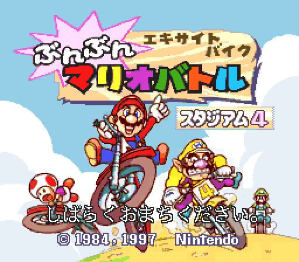
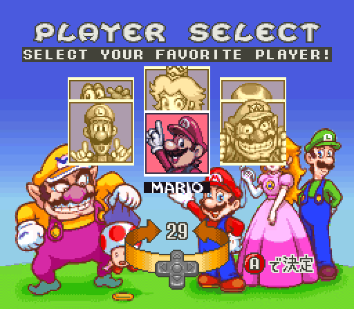
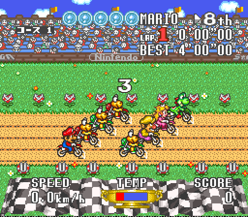
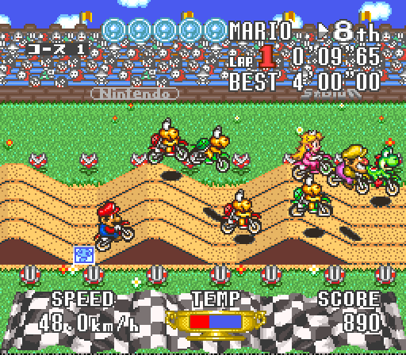
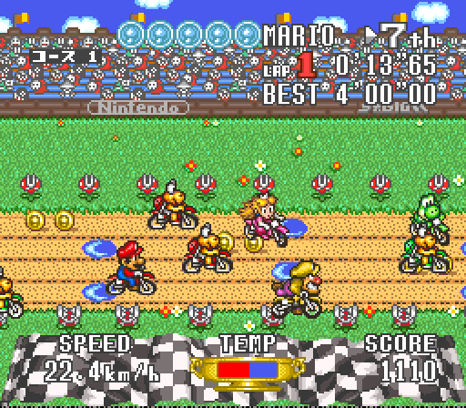
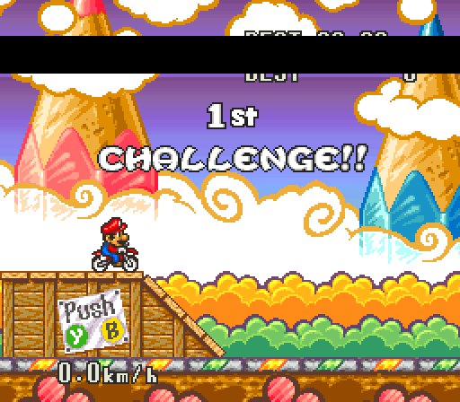
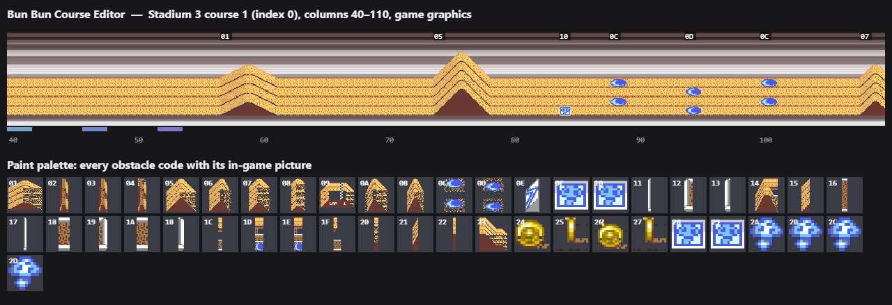

# Excitebike: Bun Bun Mario Battle — decompilation and native PC port

*Excitebike: Bun Bun Mario Battle* (エキサイトバイク ぶんぶんマリオバトル) was a
1997 Satellaview game, broadcast to Super Famicom owners in Japan in four
weekly "Stadiums". This project disassembles, decompiles and recompiles it
into a native PC game, then builds on top of it: all characters in one
roster, CPU rivals in every race, no broadcast clock to wait for, a settings
GUI, mods and a course editor that draws the game's own track.

| | | |
|---|---|---|
|  |  |  |
| Title (Stadium 4) | Six characters, Luigi and Peach included | Every race with seven CPU rivals |
|  |  |  |
| Ramps and rivals | The pack on a straight | The jump contest |

> **You must own the game.** No ROM data is in this repository. Everything
> derived from the game (generated C, embedded data, editor graphics) is
> produced locally from your own dumps and is git-ignored. A built
> executable contains the game: keep it for yourself.

## The PC port

Two executables are built from your dumps of the Stadiums:

* **`BunbunS4SNESRecomp.exe`**: the main game, the Stadium 3–4 engine (Gen B).
* **`BunbunS1SNESRecomp.exe`**: the Stadium 1–2 engine (Gen A), kept for the
  original Stadium 1–2 experience.

What the port adds:

| Feature | |
|---|---|
| **Expanded roster** | Mario, Yoshi, Kinopio, Wario, Peach and Luigi in one player select (Luigi's rider set and voice come from the Stadium 3 dump) |
| **CPU rivals in every race** | The original runs the free runs alone and meets the seven rivals only in the final; the port fills every race (the engine's eight rider slots) |
| **No broadcast clock** | Each screen moves on as soon as it is done instead of waiting for the satellite schedule; the original timing is one switch away |
| **Skip buttons** | A or Start ends the player-select countdown, Start skips the course preview and results, Select ends a race |
| **Settings GUI** | The launcher (also **Ctrl+L** / Select+L3 in game): controls per player, display, audio, rewind, save states and the **Mods** page |
| **Mods page** | Game options, a PNG rider sheet per character, a replacement sound folder, a custom course per slot, one switch per `mods/` folder |
| **Course editor** | Opens on the game's courses and draws them with the game's own graphics; saves courses both engines play |
| **No ROM needed after the build** | Your dumps are built into the executable; it runs from any folder |
| **Stadium 1–2 courses** | Play the Stadium 1 or 2 courses in the Stadium 3–4 engine |

Details, controls and every option: [port/README.md](port/README.md).
Modding: [docs/MODDING.md](docs/MODDING.md).

## The course editor



`editor/course_editor.html` sits beside each built executable and runs in a
browser, offline. It opens straight onto all twenty original courses of both
engines and draws them as the game does: the build extracts the courses, and
`port/tools/editor_graphics.py` captures every obstacle's picture by running
the game on its course preview. Paint columns with a code, insert, delete,
copy and paste, undo, and save `courseN.bin`; pick it on the Mods page (or
drop it in `mods/<name>/courses/`) and the game plays it.

## Progress

| | Stadium 1 | Stadium 2 | Stadium 3 | Stadium 4 |
|---|---|---|---|---|
| Disassembly (rebuilds byte for byte) | 407 / 407 routines | 406 / 406 | 532 / 532 | 532 / 532 |
| Hand-written C (tested against the original) | 152 / 407 | — | — | 207 / 532 |

The disassembly reassembles into identical dumps. Decompiled routines are
checked by `tools/difftest816.py`, which runs each one against the original
code on random machine states, and are then built into the port in place of
the recompiled code. Progress is tracked on
[ByteMatch](https://bytematch.dev/Tenome/Excitebike--Bun-Bun-Mario-Battle)
from the CI reports; [docs/PROGRESS.md](docs/PROGRESS.md) explains them.

## Building

Requirements: Python 3 (with Pillow and numpy for the editor graphics),
CMake, a C compiler (Visual Studio 2022 or later on Windows), and your dumps
of the Stadium 1, 3 and 4 broadcasts.

```bash
git submodule update --init --recursive
cd port
bash tools/regen.sh      --rom /path/to/s1.sfc --cfg-roots   # Stadium 1-2 engine
bash tools/regen_genb.sh --rom /path/to/s4.sfc --cfg-roots   # Stadium 3-4 engine
cmake -S . -B build
cmake --build build --config Release
python tools/editor_graphics.py                              # optional: editor graphics
```

The regen scripts verify each dump, generate the recompiled C and build your
dumps into the executables (`s3.sfc` and `s1.sfc` are found beside the
`--rom` you pass). The executables land in `port/build/genb/Release/` and
`port/build/Release/`.

## Research and tools

* [docs/NOTES.md](docs/NOTES.md): memory map, BS-X interface, routines, course format, every course code
* [docs/ROMMAP.md](docs/ROMMAP.md): what every part of the dumps is
* [docs/DECOMP.md](docs/DECOMP.md): how the decompilation and its tests work
* [docs/PLAN.md](docs/PLAN.md): phases and the state of each step
* `tools/bsdis.py` (BS-X-aware recursive disassembler), `tools/build.py`
  (reassembly), `tools/lift816.py` (mechanical C), `tools/difftest816.py`
  (tests), `tools/port_hand.py` (carries routines between versions),
  `tools/course.py`, `tools/assets.py`, `tools/sound.py`
* `c/hand/`: the hand-written C; `config/<ver>/names.txt`: routine names

## License

The project's own code is under [LICENSE](LICENSE). The recompilation
framework (`port/snesrecomp`) and launcher (`port/recomp-ui`) carry their own
terms. Neither covers the game, which is not distributed here.
